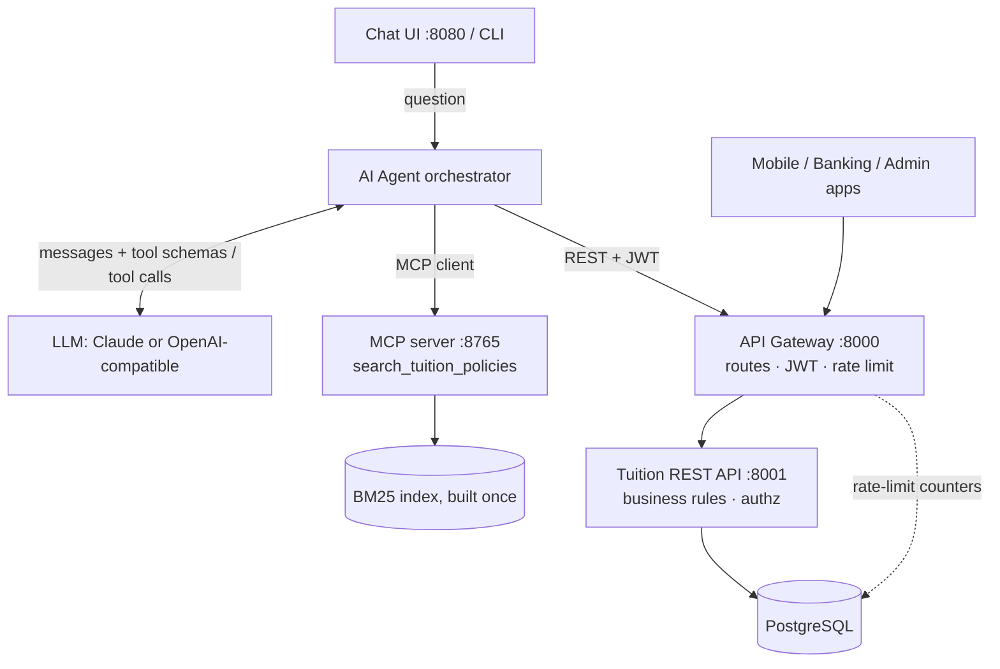
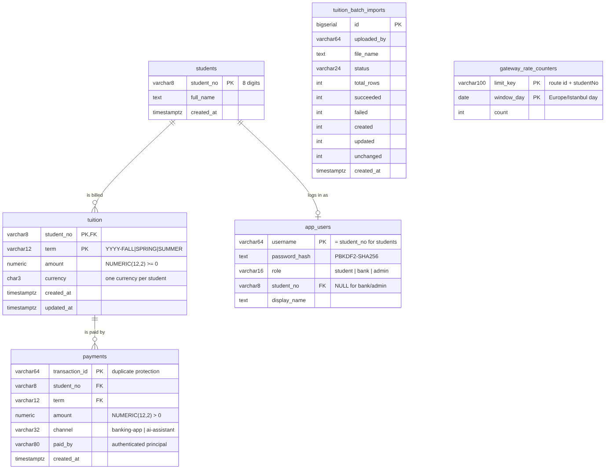

# AI Tuition Assistant — SE 4458 Midterm 1, Group 1

Gizem Erdinç · Software Architecture & Design of Modern Large Scale Systems

A conversational assistant that answers tuition questions. The LLM **chooses tools** and the **agent executes
them** on two separate paths:

* **MCP path:** agent (MCP client) → **MCP server** `search_tuition_policies` → BM25 index of `University_Tuition_Policies.md`
* **REST path:** agent → **API Gateway** `/api/v1/...` → **Tuition REST API** → **PostgreSQL**



The LLM never calls a backend. It returns tool calls; the agent validates and executes them and returns the
results to the LLM, which writes a grounded answer with policy section references.

## Contents
1. [Requirement checklist](#1-requirement-checklist)
2. [Run it](#2-run-it)
3. [Test data and reproduction steps](#3-test-data-and-reproduction-steps)
4. [AI agent](#4-ai-agent)
5. [MCP server and indexing](#5-mcp-server-and-indexing)
6. [API Gateway](#6-api-gateway)
7. [REST API contract](#7-rest-api-contract)
8. [Database, ER model, authentication](#8-database-er-model-authentication)
9. [Unit tests](#9-unit-tests)
10. [Cloud deployment](#10-cloud-deployment)
11. [LLM cost and low-cost testing](#11-llm-cost-and-low-cost-testing)
12. [Assumptions](#12-assumptions)
13. [Demo video checklist](#13-demo-video-checklist)
14. [Project structure](#14-project-structure)

---

## 1. Requirement checklist

| Requirement (midterm document) | Where |
|---|---|
| LLM agent with **real tool/function calling** (no keyword routing) | `agent/orchestrator.py`, `agent/llm.py` (§4) |
| MCP server built with the **official MCP SDK**, exposing `search_tuition_policies(query)` | `mcp_server/server.py` (§5) |
| Document chunked and indexed **before** queries, not per question | `mcp_server/indexer.py`, `mcp_server/index/policy_index.json` (§5) |
| Excerpts with section references; 3 distinct retrieval queries | [`docs/evidence/mcp_retrieval_tests.txt`](docs/evidence/mcp_retrieval_tests.txt) |
| Transactional REST APIs (all 6 operations) + server DB | `tuition_api/` + PostgreSQL (§7, §8) |
| **All** REST calls (including the agent's) through an API Gateway; versioned routes; protected route; error response | `gateway/main.py`, [`docs/evidence/gateway_evidence.md`](docs/evidence/gateway_evidence.md) (§6) |
| 3 queries / student / day, **keyed by student identity** (not IP) | gateway route `mobile-query-tuition` (§6) |
| JWT authentication and authorization; the agent cannot read another student's data | §8, §4 |
| Explicit confirmation before payment | two-phase `pay_tuition` (§4) |
| Swagger UI / OpenAPI | `http://localhost:8000/docs` (via gateway), [`docs/openapi.json`](docs/openapi.json) |
| ER / data model | [`docs/er-diagram.png`](docs/er-diagram.png), `tuition_api/schema.sql` |
| Unit tests for every REST operation (success + failure), runnable without cloud or LLM | `tests/`, [`docs/evidence/pytest_output.txt`](docs/evidence/pytest_output.txt), CI in `.github/workflows/tests.yml` (§9) |
| Tool trace (tool names, inputs, results, final answer) | `python -m agent.cli --demo` → `docs/traces/*.json`; trace panel in the chat UI |
| Cloud deployment (API, MCP, gateway, DB) | `deploy/azure/deploy.sh` (§10) |
| LLM cost + low-cost approach | §11 |
| Assumptions | §12 |

## 2. Run it

### Option A: Docker (whole stack)

```bash
cp .env.example .env                 # add your LLM key (only the agent needs it)
docker compose up -d --build
docker compose run --rm tuition-api python -m tuition_api.seed
```

| Service | URL |
|---|---|
| Chat UI | http://localhost:8080 (sign in `20210001 / student123`) |
| API Gateway | http://localhost:8000 (Swagger: `/docs`, route table: `/gateway/routes`) |
| MCP server (Streamable HTTP) | http://localhost:8765/mcp |
| Tuition API | internal only (`tuition-api:8001`); reachable through the gateway |

### Option B: Python services locally, PostgreSQL in Docker

Requires Python 3.11+.

```bash
docker compose up -d db                       # or any PostgreSQL 14+; set DATABASE_URL in .env
python -m venv .venv && source .venv/bin/activate      # Windows: .venv\Scripts\activate
pip install -r requirements.txt
cp .env.example .env                          # Windows: copy .env.example .env
python run_all.py                             # seeds DB, builds index, starts all 4 services
```

## 3. Test data and reproduction steps

`python -m tuition_api.seed` resets the database to this state:

| Account | Password | Role | Data |
|---|---|---|---|
| 20210001 | student123 | student | 2026-FALL paid · 2027-SPRING 6,000 USD, 3,000 paid → **balance 3,000** |
| 20210002 | student123 | student | 2026-FALL 4,500 unpaid (overdue) · 2027-SPRING 4,500 unpaid → balance 9,000 |
| 20210003 | student123 | student | 2027-SPRING 200 unpaid (below the $300 installment threshold, Policy §3.1) |
| 20210004 | student123 | student | 2027-SPRING fully paid |
| bank | bank123 | bank | Banking-app integration client |
| admin | admin123 | admin | University web site admin |
| 20220001–20220030 | — | — | 2027-SPRING tuition for paging the unpaid list (every 3rd one is fully paid) |

Reproduction steps:

```bash
pytest -v                                      # 1. unit tests (needs only PostgreSQL)
python -m mcp_server.demo_queries              # 2. three MCP retrieval queries over the MCP protocol
python scripts/gateway_evidence.py             # 3. gateway: public/protected routes, errors, rate limit
python -m tuition_api.seed                     #    (reset data after step 3)
python -m agent.cli --demo                     # 4. agent scenarios with tool trace (needs LLM key)
```

Sample admin CSV: [`docs/sample_tuition_batch.csv`](docs/sample_tuition_batch.csv).

## 4. AI agent

**Workflow:** user question → LLM chooses tools → agent executes MCP and/or REST calls → results go back to
the LLM → answer citing "(Policy §x.y)". The loop allows at most 6 LLM steps.

| Tool offered to the LLM | Executed via | Notes |
|---|---|---|
| `search_tuition_policies(query, top_k)` | MCP client → MCP server | Schema is **discovered** with MCP `list_tools()` at start-up, not hard-coded |
| `get_tuition_balance(term?)` | Gateway → `GET /api/v1/banking/tuition/{studentNo}` | No `studentNo` parameter: identity comes from the session |
| `pay_tuition(term, amount)` | Gateway → `POST /api/v1/banking/payments` | Only runs after explicit confirmation |

Rules enforced **in code**, not only in the prompt:

* **No access to other students' data.** Neither REST tool has a student-number parameter. The student number
  comes from the logged-in session and its JWT. If the LLM sends a `studentNo` anyway, it is ignored and a
  `GUARD` trace event is logged. The gateway and the API also check the JWT, so a prompt such as "show the
  balance of 20210002" cannot work.
* **Explicit payment confirmation (Policy §7.3).** When the LLM calls `pay_tuition`, the agent:
  1. validates the term and amount;
  2. pre-checks the live balance through the gateway;
  3. generates the transaction ID;
  4. **stops** and shows a confirmation card with student, term, amount, current balance → new balance, and
     transaction ID.

  `POST /payments` is called only from `resolve_confirmation(approve=True)`. The pending action can be used
  once, belongs to one session and expires after 5 minutes. If the student cancels, ignores it, or the action
  expires, the LLM receives `CANCELLED_BY_STUDENT`, `NOT_CONFIRMED` or `CONFIRMATION_EXPIRED` and nothing is
  charged. Because the transaction ID is fixed before confirmation, a retry or double click cannot record two
  payments (Policy §7.4).
* "Pay part of my balance" with no amount: the tool description and system prompt make the LLM ask for the
  amount, and the agent rejects a call without a valid term and amount.

Providers: Anthropic Claude (`tool_use`) or any OpenAI-compatible Chat Completions endpoint (`tool_calls`):
OpenAI, Groq, Ollama. Both are behind a provider-neutral message history.

**Trace format** (UI panel and `docs/traces/*.json`):
`{step, type: LLM | MCP | REST via Gateway | CONFIRMATION | GUARD, name, input, output, status, ms, endpoint}`.

### Required interactions

`python -m agent.cli --demo` runs these and saves the full trace and token usage to `docs/traces/`:

| # | Question | Expected tools |
|---|---|---|
| 1 | When is the payment deadline? | **MCP only** → §2.1, §2.2 |
| 2 | What is my balance? | **REST only** → balance 3,000 USD |
| 3 | Can I pay my outstanding balance in installments? | **REST + MCP** → 3,000 ≥ $300 (§3.1), up to 3 installments (§3.2), approval not implied (§3.4) |
| 4 | Pay part of my balance: 1000 USD for 2027-SPRING. | pre-check → **confirmation** → `POST /payments` → remaining 2,000 |

Evidence screenshots: `docs/evidence/agent_mcp_only.png`, `agent_rest_only.png`, `agent_combined.png`,
`agent_payment_confirmed.png`.

## 5. MCP server and indexing

* **SDK:** official `mcp` Python SDK v2 (`MCPServer`). Transports: stdio, or Streamable HTTP at `/mcp`
  (used in Docker and in the cloud).
* **Tool schema** (from `list_tools()`):

```json
{
  "name": "search_tuition_policies",
  "description": "Search the official University Tuition Policies document. ...",
  "inputSchema": {"type": "object", "required": ["query"],
                  "properties": {"query": {"type": "string"},
                                 "top_k": {"type": "integer", "default": 3}}}
}
```

* **Response**, following the shape in Section 9 of the policy document:

```json
{"document": "University_Tuition_Policies.md", "document_id": "UNI-TUITION-2026-01",
 "query": "installment eligibility", "match_count": 3,
 "matches": [{"section": "3.1", "heading": "Eligibility", "text": "Students with an outstanding balance of at least **$300** ...",
              "reference": "Section 3.1 — Installment policy › Eligibility", "score": 5.385,
              "matched_terms": ["eligible", "install"], "chunk_id": "s3.1"}]}
```

* **Chunking:** each numbered heading (`## 1.`, `### 3.2`) is one chunk, so every hit maps to one citable
  section. The result is 25 chunks. Code fences are not parsed as headings, and sections over 160 words are
  split on paragraph boundaries.
* **Ranking:** Okapi BM25 (k1 = 1.5, b = 0.75) with:
  * stop-word removal;
  * light stemming (`installments → installment`, `eligibility → eligible`, `paid/payment → pay`);
  * section-title tokens weighted ×3 and parent-title tokens ×2;
  * a small query-side synonym list (`split → installment`, `penalty → late fee`, …);
  * a minimum score, so unrelated queries return nothing.

  It uses the standard library only; embeddings were not needed (allowed by the assignment).
* **Indexed once:** `python -m mcp_server.indexer` (also run in the Docker build) writes
  `mcp_server/index/policy_index.json` with the document's SHA-256. The server loads it at start-up and
  rebuilds only if the document changed (tested).
* **Three retrieval tests** (deadline → §2.1, installment eligibility → §3.1, early withdrawal → §6.1):
  [`docs/evidence/mcp_retrieval_tests.txt`](docs/evidence/mcp_retrieval_tests.txt). Eight more query → section
  checks are in `tests/test_policy_search.py`.

## 6. API Gateway

**Choice:** a dedicated gateway service (`gateway/main.py`, FastAPI + httpx), deployed as its own container.
The assignment allows "Kong, or equivalent". It was chosen so that the required policies, especially the
per-student rate limit, are implemented explicitly, run the same way locally and in the cloud, and are covered
by automated tests.

* **Gateway URL:** local `http://localhost:8000`; cloud `https://<gateway-fqdn>` (§10)
* **Route mappings** (`GET /gateway/routes`):

| Route id | Public route (versioned) | Upstream | Auth at gateway | Rate limit |
|---|---|---|---|---|
| auth-token | `POST /api/v1/auth/token` | tuition-api `/api/v1/auth/token` | — | — |
| mobile-query-tuition | `GET /api/v1/mobile/tuition/{studentNo}` | tuition-api | — | **3/day per studentNo** |
| banking-query-tuition | `GET /api/v1/banking/tuition/{studentNo}` | tuition-api | JWT: student, bank | — |
| banking-pay-tuition | `POST /api/v1/banking/payments` | tuition-api | JWT: student, bank | — |
| admin-add-tuition | `POST /api/v1/admin/tuition` | tuition-api | JWT: admin | — |
| admin-add-tuition-batch | `POST /api/v1/admin/tuition/batch` | tuition-api | JWT: admin | — |
| admin-unpaid-tuition | `GET /api/v1/admin/tuition/unpaid` | tuition-api | JWT: admin | — |

* **Authentication at the edge:** JWT signature, expiry, issuer and role are checked before forwarding
  (401/403). The API checks again (defence in depth) and also enforces ownership: a student token works only
  for that student's own number.
* **Rate limit keyed by student identity:** the counter key is `route id + studentNo` from the path, with a
  fixed calendar-day window (Europe/Istanbul). Every attempt counts. Counters are stored in PostgreSQL with one
  atomic `INSERT … ON CONFLICT … RETURNING`, so all gateway replicas share them and a restart does not reset
  them. Responses carry `X-RateLimit-Limit/Remaining/Reset`; the 4th call gets `429` with `Retry-After`.
* **Versioning:** `/api/v1` is the only supported version. `/api/v2/...` returns `404 UNKNOWN_API_VERSION`.
  Unknown paths return `404 ROUTE_NOT_FOUND`; a wrong method returns `405` with `Allow`.
* Also: `X-Request-ID` correlation, JSON access log (route, principal, status, latency), `502`/`504` on
  upstream failure, Swagger UI published at `/docs`.
* **Example error response** (protected route without token):

```http
GET /api/v1/banking/tuition/20210001
HTTP 401
{"error": {"code": "UNAUTHENTICATED", "message": "Bearer token required"}}
```

Full request/response evidence (public route, protected route with and without token, cross-student 403,
admin 403, paged unpaid list, payment, duplicate, overpayment, rate limit 429, unknown version):
[`docs/evidence/gateway_evidence.md`](docs/evidence/gateway_evidence.md).

## 7. REST API contract

Swagger UI: `http://localhost:8000/docs` (through the gateway). Spec: [`docs/openapi.json`](docs/openapi.json)
(`python scripts/export_openapi.py`).

Conventions:
* JSON uses camelCase.
* Money is a decimal with at most 2 places, stored as `NUMERIC(12,2)`.
* Every error has the shape `{"error": {"code", "message", "details"?}}`.

| Client | Operation | Endpoint | Auth | Paging |
|---|---|---|---|---|
| Mobile | Query Tuition | `GET /api/v1/mobile/tuition/{studentNo}?term=` | No (3/day/student) | No |
| Banking | Query Tuition | `GET /api/v1/banking/tuition/{studentNo}?term=` | Yes | No |
| Banking | Pay Tuition | `POST /api/v1/banking/payments` | Yes | No |
| Admin | Add Tuition | `POST /api/v1/admin/tuition` | Yes (admin) | No |
| Admin | Add Tuition – Batch | `POST /api/v1/admin/tuition/batch` (multipart `file`) | Yes (admin) | No |
| Admin | Unpaid Tuition Status | `GET /api/v1/admin/tuition/unpaid?term=&page=1&pageSize=20` | Yes (admin) | Yes |
| All | Get token | `POST /api/v1/auth/token` | — | — |

**Term or overall balance.** With `term` (`YYYY-FALL|SPRING|SUMMER`) the response has `scope: "TERM"`. Without
it, the response has `scope: "OVERALL"`: totals over all terms plus a `terms[]` breakdown, each with status
`PAID | PARTIALLY_PAID | UNPAID`.

```json
{"studentNo":"20210001","scope":"TERM","term":"2027-SPRING","currency":"USD","tuitionTotal":6000.0,
 "paidTotal":3000.0,"balance":3000.0,"terms":[{"term":"2027-SPRING","tuitionTotal":6000.0,
 "paidTotal":3000.0,"balance":3000.0,"status":"PARTIALLY_PAID"}]}
```

**Pay Tuition** (simulated; no card processing). Request: `{studentNo, term, amount, transactionId}`.
Response 201: `{paymentStatus: "SUCCESS", coverage: "PARTIAL"|"FULL", transactionId, paidAmount, remainingBalance, currency, paidAt}`.

| Case | Response |
|---|---|
| `transactionId` already used | **409** `DUPLICATE_TRANSACTION`, with `details.originalTransaction` so a client that timed out learns the outcome |
| amount > outstanding balance (including a fully paid term) | **422** `AMOUNT_EXCEEDS_BALANCE` + `outstandingBalance` |
| no tuition for that term | **404** `TUITION_NOT_FOUND` |
| amount ≤ 0, more than 2 decimals, malformed IDs | **400** `VALIDATION_ERROR` |
| student token paying for another student | **403** `FORBIDDEN` |

Concurrency: the tuition row is locked with `SELECT … FOR UPDATE`, and `transaction_id` is the primary key.
Two tests check this: 20 parallel payments of 500 against a 3,000 balance give exactly 6 successes, and 8
parallel requests with the same ID record exactly 1 payment.

**Add Tuition: duplicate-handling rules** for an existing (studentNo, term):

| Case | Result |
|---|---|
| no record | `CREATED` (unknown student numbers are registered) |
| same amount and currency | `UNCHANGED` (idempotent) |
| different amount | `UPDATED` + `previousAmount` |
| currency differs from the student's existing records | **409** `CURRENCY_MISMATCH` (one currency per student, no implicit FX) |
| new amount lower than what has already been paid | **409** `AMOUNT_BELOW_PAID` |

**Add Tuition – Batch.** CSV with header `studentNo,term,amount,currency`, UTF-8, ≤ 1 MB, ≤ 10,000 rows.
* Each row follows the same rules inside its own SAVEPOINT: bad rows are reported, good rows are committed.
* A (studentNo, term) repeated **in the same file** is applied once; later rows get `DUPLICATE_IN_FILE`.
* Response: `{transactionStatus: COMPLETED | COMPLETED_WITH_ERRORS | FAILED, totalRows, succeeded, failed, created, updated, unchanged, errors:[{line, studentNo, term, code, message}]}`.
* Every import is logged in `tuition_batch_imports`.

**Unpaid Tuition Status.** Students with balance > 0 for the term, ordered by student number:
`{term, page, pageSize, totalItems, totalPages, items:[{studentNo, tuitionTotal, paidTotal, balance, currency}]}`.
`pageSize` must be 1–100.

## 8. Database, ER model, authentication

PostgreSQL 16 (server database). The schema is in `tuition_api/schema.sql` and is applied idempotently at
start-up under an advisory lock.



* Balances are **derived** (`tuition.amount − Σ payments.amount`), never stored, so they cannot drift away
  from the payment ledger.
* `gateway_rate_counters` belongs to the gateway and lives in the same server for simplicity. In production it
  would be Redis or a separate database.

**Authentication:** `POST /api/v1/auth/token` returns an HS256 JWT (`sub`, `role`, `iss`, `exp` = 30 min).
Passwords are stored as PBKDF2-SHA256 hashes (200k iterations). Use *Authorize* in Swagger.

| Role | Allowed |
|---|---|
| student | query/pay **own** account only (`sub` must equal `studentNo`) |
| bank | query/pay any account (banking-app integration) |
| admin | add tuition, batch upload, unpaid list |

## 9. Unit tests

```bash
docker compose up -d db                      # any PostgreSQL works; see TEST_DATABASE_URL
pytest -v
```

* The tests create a throw-away database (`tuition_test_<pid>`), reseed it before every test and drop it at the
  end. No cloud and no LLM are needed.
* The agent tests use a scripted LLM test double. The MCP server, gateway, API and database in those tests are
  real.
* GitHub Actions runs the same suite on every push (`.github/workflows/tests.yml`).

**Result: 62 passed.** See [`docs/evidence/pytest_output.txt`](docs/evidence/pytest_output.txt).

| Operation | Success tests | Failure / edge tests |
|---|---|---|
| Auth token | valid credentials | wrong password, missing field |
| Mobile Query Tuition | overall breakdown, term balance | unknown student 404, invalid studentNo/term 400, term without record |
| Banking Query Tuition | own account, bank client any account | no token 401, other student 403, admin role 403, bad token |
| Pay Tuition | partial then full | duplicate ID 409, over balance 422, paid term, invalid amounts/IDs 400, other student 403, no token, unknown term 404, **concurrency** ×2 |
| Add Tuition | create / unchanged / update | currency mismatch, amount below paid, validation ×4, student 403, no token |
| Add Tuition – Batch | all-valid file, mixed file with counts | invalid header, empty file, all rows invalid, wrong role |
| Unpaid Tuition Status | paging (23 items / 3 pages), page beyond end | pageSize > 100, page 0, missing term, no token, student 403 |
| Gateway | forwarding, JWT at edge, route table + Swagger | forged token, wrong role, cross-student, 429 + reset next day, other student not limited, 404/405 |
| MCP / index | 8 query → section checks, response shape, real MCP stdio call | no-match query, rebuild only on document change |
| Agent | MCP-only, REST-only, combined, confirmed payment | smuggled studentNo ignored, cancel, abandon, overpayment, replayed confirmation |

## 10. Cloud deployment

The target is **Microsoft Azure** (works with an *Azure for Students* subscription):

| Component | Azure service |
|---|---|
| Tuition API | Container App, **internal** ingress (not reachable from the internet) |
| API Gateway | Container App, external HTTPS ingress |
| MCP server | Container App, external HTTPS ingress (`/mcp`) |
| Agent / chat UI | Container App, external |
| Database | Azure Database for PostgreSQL Flexible Server, Burstable B1ms |
| Images | Azure Container Registry (one image; `SERVICE` env var selects the service) |

```bash
az login
export LLM_API_KEY=...            # agent only
bash deploy/azure/deploy.sh       # builds the image in ACR, creates the DB and the 4 container apps, prints URLs
bash deploy/azure/seed.sh         # loads test data; writes docs/evidence/gateway_evidence_cloud.md
az group delete -n rg-se4458-tuition --yes      # tear down after grading
```

| | URL |
|---|---|
| Gateway | `https://<gateway>.azurecontainerapps.io` ← *fill in after deployment* |
| Swagger | `https://<gateway>.azurecontainerapps.io/docs` |
| MCP | `https://<mcp-server>.azurecontainerapps.io/mcp` |
| Chat UI | `https://<agent>.azurecontainerapps.io` |

Secrets (DB URL, JWT secret, LLM key) are stored as Container App secrets, not in the image. Container Apps
scale to zero, so cost is mainly the B1ms database. Remove the resource group after grading.

## 11. LLM cost and low-cost testing

* One scenario uses **2 LLM calls** (tool selection plus the final answer). The payment scenario uses 2 calls
  plus a resume after confirmation.
* Input per call is roughly 1.5–3k tokens (system prompt, 3 tool schemas, history, tool results) and output is
  under 300 tokens.
* `--demo` prints and saves the **measured** token usage (`token_usage` in the trace JSON). Cost = input
  tokens × input price + output tokens × output price, using the current
  [Claude pricing](https://platform.claude.com/docs/en/about-claude/pricing) or your provider's page.
* With the default low-cost model (`claude-haiku-5-5`) the whole demo uses on the order of 25k input tokens,
  which is a few cents.

Ways to keep the cost low or zero:
* the default model is Haiku-class and `max_tokens` is 1024;
* tool results are truncated (6k characters) and policy search returns the top 3 matches;
* **Groq's free tier** or a **local Ollama** model works through `LLM_PROVIDER=openai` + `LLM_BASE_URL`;
* the whole test suite runs with a scripted LLM, so it needs **no API key and costs nothing**.

## 12. Assumptions

**Policy interpretation**
* The assistant receives today's date. A Fall 2026 balance after September 30, 2026 is overdue (§2.1).
* Late fees are explained (2% one-time, §4.1) but never computed or posted. The document says fees are not
  posted automatically, and the API has no fee data.
* Installments: the agent can say that a balance ≥ $300 *may be requested* as an arrangement (§3.1) of up to
  three installments (§3.2). Approval data does not exist in the API, so the agent must never say a plan is
  approved (§3.4). A partial payment is not an installment approval.
* Section 9 (implementation guidance) is indexed like every other section. Its response format was adopted
  for the MCP tool.

**Payments**
* Simulated only. Overpayments are **not** supported (§7.2) and are rejected with 422.
* Idempotency (§7.4) is the unique `transactionId`. A repeat returns 409 with the original transaction
  instead of a second record. The agent generates the transaction ID before asking for confirmation.

**Rounding and currency**
* Amounts are exact decimals with at most 2 places. Inputs with more decimals are **rejected, not rounded**.
* Each student is billed in one currency (all seed data is USD). The overall balance is the sum across terms.

**Identity**
* A student's username is the student number.
* The agent takes identity only from the login session and never from the prompt.
* The bank role is a trusted service client.
* The mobile query is unauthenticated by specification, so it is protected by the per-student limit.

**Rate limit**
* Calendar day in Europe/Istanbul.
* Every attempt counts, including 404s (prevents enumeration).
* The term and overall variants of the query share one counter.
* Only the mobile route is limited; the authenticated banking query is not.

**Deployment**
* One container image, four services.
* The MCP server is public and unauthenticated because it serves only the public policy document.
* The JWT secret is shared by the gateway and the API (HS256). RS256 + JWKS would be the next step.
* `DATABASE_URL` points at a managed PostgreSQL in the cloud and at a Docker PostgreSQL locally.

**Errors**
* Validation errors return 400 (`VALIDATION_ERROR`) with per-field details. Business-rule conflicts return
  409/422 with stable `code` values.

## 13. Demo video checklist

1. `docker compose up` / `run_all.py`; show `/gateway/routes` and Swagger at the gateway URL.
2. `pytest -v` → 62 passed.
3. `python -m mcp_server.demo_queries` → three retrieval queries.
4. Gateway: protected route without and with token, 403 for another student, mobile query 4× → 429
   (`scripts/gateway_evidence.py`).
5. Chat UI as `20210001`, with the trace panel open:
   * "When is the payment deadline?" (MCP)
   * "What is my balance?" (REST)
   * "Can I pay my outstanding balance in installments?" (both)
   * "Pay part of my balance" → give the amount → **Confirm** → the balance drops.
6. Ask "What is the balance of student 20210002?" → refused (own account only).

## 14. Project structure

```
agent/          llm.py (Claude + OpenAI-compatible adapters), orchestrator.py (loop, confirmation, guards),
                backends.py (MCP client, gateway client), web.py + static/index.html (chat UI), cli.py (demo)
mcp_server/     indexer.py (chunking + BM25), server.py (MCP tool), demo_queries.py, index/policy_index.json
gateway/        main.py (routes, JWT at edge, per-student rate limit, proxy)
tuition_api/    main.py (FastAPI + Swagger), service.py (business rules), schema.sql, db.py, security.py, seed.py
tests/          62 tests: API, gateway, MCP/index, agent
deploy/azure/   deploy.sh, seed.sh
docs/           University_Tuition_Policies.md (provided), openapi.json, er-diagram.png/.mmd, evidence/
Dockerfile, docker-compose.yml, start.py, run_all.py, .env.example, .github/workflows/tests.yml
```
